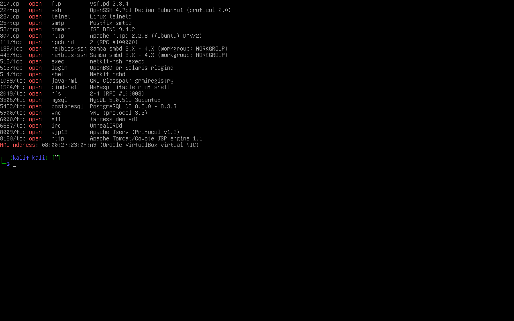
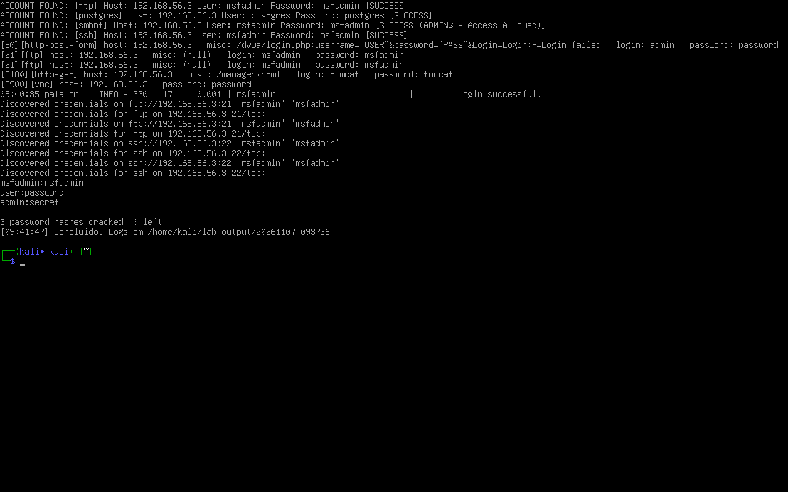
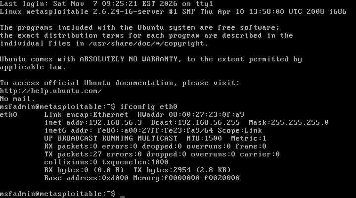

# Laboratório de Brute Force — Kali Linux + Metasploitable 2

Desafio final do curso **"Criando um ataque de brute force de senhas com Medusa e Kali Linux"**
(DIO/Santander): montar um laboratório isolado com Kali Linux e Metasploitable 2,
executar ataques de força bruta e password spraying com diferentes ferramentas e
documentar os resultados de forma reproduzível.

> **Aviso:** todo o conteúdo deste repositório é educacional e foi executado em VMs
> isoladas, de propriedade do autor. Não utilize estas técnicas em sistemas sem
> autorização escrita. O script recusa alvos fora de faixas privadas, salvo `FORCE=1`.

## Visão geral

- Hypervisor: VirtualBox no host `omega-server-local`
- Rede isolada host-only `vboxnet0` — `192.168.56.0/24`
- Kali Linux `192.168.56.4` (atacante) e Metasploitable 2 `192.168.56.3` (alvo)
- Orquestrador `lab-attacks.sh` com 16 módulos e saída em `~/lab-output/<timestamp>/`
- Ferramentas: Nmap, Hydra, Medusa, Ncrack, John, Patator, WPScan, enum4linux, SMBclient, smbmap
- Ataques extras: VNC, PostgreSQL, MySQL, Tomcat Manager, bindshell 1524,
  backdoor do vsftpd 2.3.4 (CVE-2011-2523) e pós-exploração do `/etc/shadow`

## Arquitetura

| Componente | Detalhes |
|---|---|
| Host | `omega-server-local` (192.168.15.4), Ubuntu 26.04.1, 12 vCPU, 30 GB RAM |
| Hypervisor | VirtualBox 7.2.6_Ubuntu |
| Rede do lab | host-only `vboxnet0` — 192.168.56.0/24, host em .1 |
| Kali | 4 vCPU, 6144 MB, IP estático 192.168.56.4, VRDE 127.0.0.1:13389 |
| Metasploitable 2 | 1 vCPU, 1024 MB, IP estático 192.168.56.3, VRDE 127.0.0.1:13390 |
| Acesso gráfico | RDP (VRDP) via túnel SSH + Remmina |
| Acesso SSH | túnel SSH pelo host (portas 22022/22023) |

Detalhes completos em [docs/ambiente.md](docs/ambiente.md).

## Estrutura do repositório

```text
.
├── README.md
├── lab-attacks.sh              # orquestrador dos ataques (executado no Kali)
├── scripts/
│   └── vsftpd_backdoor.py      # exploit do backdoor vsftpd 2.3.4 (CVE-2011-2523)
├── wordlists/
│   ├── users.txt
│   ├── pass-small.txt
│   └── creds-stuffing.txt
├── configs/
│   ├── kali-net.sh             # fixa o IP estático do Kali
│   └── metasploitable-interfaces
├── docs/
│   ├── README.md
│   ├── planejamento.md
│   ├── ambiente.md
│   └── ataques.md
├── evidence/
│   └── 20261107-093736/        # execução final completa (run.log + logs por ferramenta)
└── images/
    ├── kali-nmap.png
    ├── kali-resumo-ataques.png
    └── metasploitable-ip-estatico.png
```

## Como reproduzir

### 1. VMs e rede

1. Crie a rede host-only (`vboxnet0`) e mantenha a subnet padrão `192.168.56.0/24`.
2. Kali: `nic1` host-only + `nic2` NAT; IP estático `192.168.56.4` (veja `configs/kali-net.sh`).
3. Metasploitable 2: `nic1` host-only; IP estático `192.168.56.3` em `/etc/network/interfaces`
   (veja `configs/metasploitable-interfaces`).
4. Ligue as VMs em headless e valide a conectividade:

```bash
VBoxManage startvm "kali-linux-2026.3-virtualbox-amd64" --type headless
VBoxManage startvm "Metasploitable 2" --type headless
# no Kali:
ping -c 2 192.168.56.3
```

### 2. Deploy do script

```bash
scp lab-attacks.sh scripts/vsftpd_backdoor.py eskokado@192.168.15.4:/tmp/
ssh eskokado@192.168.15.4 '
  VBoxManage guestcontrol "kali-linux-2026.3-virtualbox-amd64" copyto \
    --username kali --password kali /tmp/lab-attacks.sh /home/kali/lab-attacks.sh
  VBoxManage guestcontrol "kali-linux-2026.3-virtualbox-amd64" copyto \
    --username kali --password kali /tmp/vsftpd_backdoor.py /home/kali/vsftpd_backdoor.py
'
```

### 3. Execução

Dentro do Kali:

```bash
chmod +x ~/lab-attacks.sh ~/vsftpd_backdoor.py
TARGET=192.168.56.3 ~/lab-attacks.sh all
# ou módulos específicos:
TARGET=192.168.56.3 ~/lab-attacks.sh recon hydra medusa vnc db tomcat bindshell backdoor
```

Saída: `~/lab-output/<timestamp>/run.log` e um arquivo por ferramenta.

## Módulos

| Módulo | O que faz |
|---|---|
| `prep` | Gera `users.txt`, `pass-small.txt`, `creds-stuffing.txt` e subset do rockyou |
| `recon` | `nmap -sV` nas portas relevantes |
| `smb` | enum4linux(-ng), listagem de shares e smbmap (com timeout) |
| `hydra` | FTP, Telnet, credential stuffing, SSH (com aviso) e formulário DVWA |
| `ncrack` | Credencial única em SSH e lista em FTP |
| `john` | Hashes MD5-crypt de demonstração |
| `wpscan` | Enumeração de usuários/senhas se houver WordPress |
| `patator` | FTP e SSH (wrapper `fork` para Python 3.14) |
| `medusa` | SSH, FTP e Telnet |
| `vnc` | Hydra contra VNC (somente senha) |
| `db` | Medusa no PostgreSQL, nmap scripts no MySQL e acesso root sem senha |
| `tomcat` | Hydra `http-get` no Tomcat Manager (porta 8180) |
| `bindshell` | Acesso root pela porta 1524 e captura do `/etc/shadow` |
| `backdoor` | Backdoor vsftpd 2.3.4 → root → `/etc/shadow` → John |
| `spray` | Password spraying em SMB e SSH (Medusa) |
| `smb-access` | Lista `//192.168.56.3/tmp`; upload só com `ACTIVE=1` |

## Resultados validados

Execução final: `evidence/20261107-093736/` (2026-11-07).

| Vetor | Ferramenta | Credencial / resultado | Evidência |
|---|---|---|---|
| FTP (21) | Hydra, Medusa, Ncrack, Patator | `msfadmin:msfadmin` | `hydra-ftp.txt`, `medusa-ftp.txt`, `ncrack-ftp.txt`, `patator-ftp.txt` |
| SSH (22) | Medusa, Ncrack | `msfadmin:msfadmin` | `medusa-ssh.txt`, `ncrack-ssh.txt` |
| DVWA (80) | Hydra `http-post-form` | `admin:password` | `hydra-dvwa.txt` |
| SMB (445) | Medusa `smbnt` (spray) | `msfadmin:msfadmin` — `ADMIN$` | `spray-smb-msfadmin.txt` |
| PostgreSQL (5432) | Medusa | `postgres:postgres` | `medusa-postgres.txt` |
| MySQL (3306) | Nmap + mysql | root com senha vazia | `mysql-nmap.txt`, `mysql-root.txt` |
| VNC (5900) | Hydra | senha `password` | `hydra-vnc.txt` |
| Tomcat (8180) | Hydra `http-get` | `tomcat:tomcat` | `hydra-tomcat.txt` |
| Bindshell (1524) | `nc` | shell root direto | `bindshell-root.txt` |
| Backdoor vsftpd (6200) | `scripts/vsftpd_backdoor.py` | shell root + `/etc/shadow` | `backdoor-root.txt` |
| John (demo) | John | `msfadmin:msfadmin`, `user:password`, `admin:secret` | `john.txt` |
| John (shadow real) | John | `msfadmin:msfadmin`, `sys:batman`, `klog:123456789` (3/7) | `john-shadow.txt` |
| WPScan | — | não aplicável (sem WordPress) | — |

Principais telas:





## Mitigações

| Risco | Mitigação |
|---|---|
| Credenciais padrão/fracas (FTP, SSH, SMB, VNC, Tomcat, bancos) | Senhas fortes e únicas, MFA, rotação, remoção de contas padrão |
| DVWA exposto | Não usar em produção; remover ou isolar; senha forte + MFA |
| Password spraying | Bloqueio por tentativas, detecção de múltiplos logins, limites por conta/IP |
| SMB legado (`msfadmin` com `ADMIN$`) | Desabilitar SMBv1, princípio do menor privilégio, segmentação |
| PostgreSQL/MySQL acessíveis com credencial fraca/vazia | `bind-address` local, senhas fortes, remover root sem senha |
| VNC exposto | Senha forte, túnel/VPN, restringir a origem |
| Tomcat Manager acessível | Remover o manager em produção, credenciais fortes, restringir por IP |
| Bindshell 1524 (ingreslock) | Fechar a porta, firewall, remover o serviço/backdoor |
| vsftpd 2.3.4 (CVE-2011-2523) | Atualizar o vsftpd; não expor FTP; usar SFTP |
| `/etc/shadow` legível após root | Permissões 640 `root:shadow`, hashes modernos (yescrypt/argon2), monitoramento |
| Hydra/Patator SSH falham no OpenSSH antigo | Usar Medusa ou Ncrack no laboratório (limitação de ferramenta, não do alvo) |

## Limitações encontradas

- **Hydra SSH:** `kex error` por MAC legado do OpenSSH 4.7p1; usar Medusa/Ncrack.
- **Patator SSH:** `paramiko` rejeita hostkey legado; FTP funciona.
- **Patator no Python 3.14:** necessário wrapper `fork` (embutido no script).
- **smbmap:** trava com o forkserver do Python 3.14; o script aplica `timeout 60`.
- **WPScan:** Metasploitable 2 não tem WordPress; use `WPSCAN_URL` para outro alvo.
- **Hydra VNC:** não aceita usuário; apenas `-P`/`-p`.
- **vsftpd backdoor:** só abre de forma confiável com o serviço recém-reiniciado;
  o módulo `backdoor` reinicia o vsftpd via bindshell 1524 antes do exploit.
- **MySQL antigo:** o cliente atual exige `--skip-ssl`.
- **rockyou:** apenas subset (`MAX_WORDS=1000`) para execução rápida.

## Documentação

- [docs/planejamento.md](docs/planejamento.md) — escopo, fases, critérios e riscos
- [docs/ambiente.md](docs/ambiente.md) — host, VMs, rede, acesso e troubleshooting
- [docs/ataques.md](docs/ataques.md) — módulos, comandos manuais e mapa do curso
- [docs/resultados.md](docs/resultados.md) — resumo dos achados, destaques e mitigações
- [evidence/20261107-093736/run.log](evidence/20261107-093736/run.log) — execução final

## Referências

- Curso DIO/Santander — Criando um ataque de brute force de senhas com Medusa e Kali Linux
- Metasploitable 2 — https://docs.rapid7.com/metasploit/metasploitable-2/
- CVE-2011-2523 — backdoor do vsftpd 2.3.4
- Hydra — https://github.com/vanhauser-thc/thc-hydra
- Medusa — http://www.foofus.net/jmk/medusa/medusa.html
- Ncrack — https://nmap.org/ncrack/
- John the Ripper — https://www.openwall.com/john/
- Patator — https://github.com/lanjelot/patator
